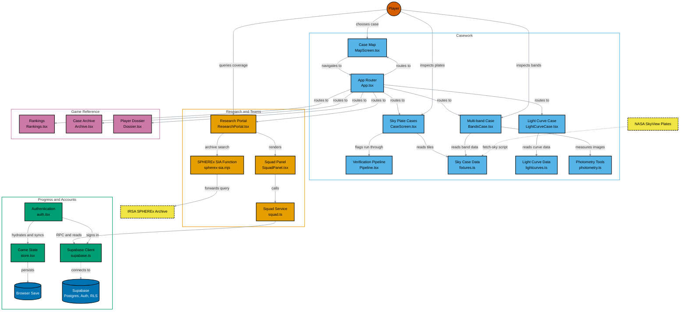

# Cosmic Detective

A game-style citizen science project by **Team Pleiades**. Players inspect real archival NASA sky plates, catch objects that moved between observations, and send every flag through a visible verification pipeline, earning XP and ranks. Squads of players can also work on live SPHEREx archive data together.

Built for the 2026 NASA Space Apps Challenge: [Planet X and SPHEREx](https://www.spaceappschallenge.org/2026/challenges/planet-x-and-spherex/).

## The challenge

NASA's SPHEREx mission maps the whole sky in 102 bands of near-infrared light, and objects such as asteroids, comets, stars and brown dwarfs reveal themselves by shifting position between images. There is far more data than a few scientists can review, so the challenge asks for a public web tool that lets anyone enter a sky position and watch how the images change over time.

Cosmic Detective approaches this as a game. Every mechanic is a plain-language version of a real verification step: comparing two exposures, subtracting one from another, checking a candidate against known catalogs, and ruling out false positives before anything is called a finding.

## Features

- **Real data first.** Sky plates come from NASA SkyView (DSS POSS-I and POSS-II, 2MASS, WISE), and the research portal queries live SPHEREx observations from IRSA. One exception today: the Chapter 4 light curves are simulated by default (see `src/data/lightcurves.ts`), and real photometry replaces them only when it is imported.
- **Detective tools.** Blink comparator, difference imaging, a multi-band compositor, and a light curve analyzer, unlocked chapter by chapter.
- **Visible verification.** Every flag runs through staged checks that fit the case type, for example stationary source, blend and halo, and catalog cross match for sky plates. The result is always shown, including rejections.
- **Progression.** XP, badges, and a rank ladder that gates tools and chapters. Rank 6 (Principal Investigator) plus an admin-granted approval can lead a research squad.
- **Accounts and cloud saves.** Username and password sign-in with progress stored in Supabase. Guest play still works with no backend.
- **Research squads.** A leader assigns live SPHEREx archive data to analysts. Analysts file findings, the leader verifies or sends them back, and verified work is filed to a **simulated** NASA intake.
- **Open Sky Research Portal.** Search the live IRSA SPHEREx archive by RA and Dec, inspect results by detector band, and view the raw observation timeline. Browse mode remains display-only; Blink and Difference stay disabled pending pixel-level validation. An imported IRSA Spectrophotometry VOTable can expose a light curve and trial-period fold only when its schema, units, target position, release, detector, exposure class, bandpass, flags, and selected fit-quality cutoff satisfy the analysis gates. Use Prepare Download from the IRSA Results pane to save the extracted spectrum. The importer currently accepts TABLEDATA serialization; compatibility with a representative downloaded IRSA export is still being validated.
- **Accessible by design.** Dark mode, light mode, and a colorblind-safe mode using the Okabe-Ito palette. Verdicts always carry an icon and a label, never color alone.

### Scientific honesty

The game never claims a confirmed discovery. Candidates are labeled as candidates for follow-up, and the squad intake is a training sandbox: reports stay inside Cosmic Detective and are never sent to NASA or any observatory.

## Architecture

The diagram uses the Okabe-Ito palette. Shapes and outlines carry meaning too: circles are people, cylinders are data stores, and dashed outlines are external systems.



## Tech stack

| Area | Choice |
|---|---|
| Frontend | Vite 6, React 19, TypeScript, plain CSS |
| Backend | Supabase (Postgres, Auth, row level security, SQL functions) |
| Hosting | Netlify (static site and a SPHEREx archive proxy function) |
| Audio | WebAudio sound effects |
| Runtime | Node.js 22 or newer |

## Getting started

### Run the game

```bash
npm install
npm run dev
```

The game runs as a guest with no setup. Progress is saved in your browser only.

### Turn on accounts and squads

1. Create a Supabase project and apply the SQL in [`supabase/migrations/`](supabase/migrations/).
2. In the project's Auth settings, turn **Confirm email** off. Accounts use a derived address and nothing is ever emailed.
3. Create `.env.local` in the repository root:

   ```dotenv
   VITE_SUPABASE_URL=https://your-project.supabase.co
   VITE_SUPABASE_ANON_KEY=your-publishable-key
   ```

4. Restart `npm run dev`. The title screen now shows **Log in** and **Create account**.

The publishable (anon) key is public by design. Never put a secret or service role key in a `VITE_` variable and never commit any `.env` file.

### Run Supabase locally (optional)

This needs Docker Desktop running.

```bash
npx supabase start     # builds a local database from supabase/migrations/
npx supabase status    # prints the local URL and publishable key
```

Put the local values in `.env.development.local`. It overrides `.env.local` during `npm run dev`, so your hosted project is untouched. Use `npx supabase db reset` to rebuild from the migrations.

### Let a test account lead a squad

Leading a squad needs Rank 6 **and** an admin-granted flag. The flag cannot be set from the browser, on purpose. Run this once in the SQL Editor:

```sql
update public.profiles set can_lead = true where lower(username) = lower('YourUsername');
```

### Scripts

| Command | What it does |
|---|---|
| `npm run dev` | Start the dev server |
| `npm run build` | Type check and build for production |
| `npm run preview` | Serve the production build locally |
| `npm run fetch-sky` | Refetch sky plates from NASA SkyView |
| `npm run fetch-spherex` | Run `scripts/fetch-spherex.mjs` |

## Documentation

| Document | Contents |
|---|---|
| [Database schema](docs/database-schema.md) | Tables and row level security policies |
| [Architecture](docs/architecture.md) | Front end structure of the game |
| [PLAN.md](PLAN.md) | Product roadmap |

## Data and credits

- Sky plates: [NASA SkyView](https://skyview.gsfc.nasa.gov/) (DSS, 2MASS, WISE).
- SPHEREx spectral images: [NASA/IPAC Infrared Science Archive (IRSA)](https://irsa.ipac.caltech.edu/).
- Art: chapter art was generated with Gemini through Netlify AI Gateway and is committed under `public/img/`.
- Challenge: [2026 NASA Space Apps Challenge](https://www.spaceappschallenge.org/2026/challenges/planet-x-and-spherex/).

### Contributors

<a href="https://github.com/yeadmuhammad/cosmic-detective/graphs/contributors">
  
</a>   
   
   
**Copyright 2026 [Team Pleiades](https://www.spaceappschallenge.org/2026/find-a-team/pleadies/)**
